# MID50-Display – Benutzerhandbuch

Stand: Firmware 1.0.0, Oktober 2026. Download und Installation der Firmware: siehe [README](README.md).

**Inhalt:** [Überblick](#überblick) · [Anschluss](#anschluss-an-den-antrieb) · [Erste Inbetriebnahme](#erste-inbetriebnahme) ·
[Bedienung am Display](#bedienung-am-display) · [Webinterface](#webinterface) · [Laden](#laden) ·
[Fahrten](#fahrten-verlauf-und-aufzeichnung) · [Einstellungen](#einstellungen) · [Zugangsschutz](#zugangsschutz) ·
[Firmware-Update](#firmware-update-und-system) · [Fehlersuche](#fehlersuche)

## Überblick

Das MID50-Display ist eine runde Akku-, Tacho- und Diagnoseanzeige für Mopeds mit SecondRide-Elektroumbau. Es arbeitet mit beiden SecondRide-Antrieben:

- **SR23/SR24** mit dem Steuergerät „Günther“
- **MID50** mit VESC-Motorcontroller

Welcher Antrieb angeschlossen ist, erkennt das Display selbst. Werte, die ein Antrieb nicht liefert, erscheinen als „--“.

**Was das Display zeigt:**

- Ladestand, Akkuspannung, Akkustrom und Leistung
- Geschwindigkeit, Tages- und Gesamtkilometer, Reichweite und Verbrauch
- Temperaturen von Akku, Regler und Motor, Einzelzellen (MID50)
- Fahrbereitschaft, Bremse, Leistungsbegrenzung und Fehler als Symbole
- Beschleunigung in Fahrtrichtung

**Was es zusätzlich kann:**

- Webinterface im WLAN oder über den eigenen Hotspot, mit Diagrammen, Fahrtenbuch und Ladehistorie
- Smartplug (Shelly oder Tasmota) beim Laden ein- und ausschalten, mit einstellbarer Ladegrenze
- WhatsApp-Nachricht, wenn die Ladegrenze erreicht ist
- Daten per MQTT an eine Hausautomation senden
- Firmware-Update über das Webinterface

## Anschluss an den Antrieb

Das Display bekommt seine Daten je nach Antrieb per Kabel oder per Bluetooth.

| Antrieb | Verbindung | Kopplung nötig |
|---|---|---|
| SR23/SR24 | Kabel: USB-Anschluss des Antriebs → ESP32-Mini → RX/TX des Displays | nein |
| SR23/SR24 | Bluetooth: SR-Bridge am USB-Anschluss des Antriebs („CDC-BLE-Bridge“) | ja |
| MID50 | Bluetooth: direkt zum Antrieb | ja |

**SR23/SR24 per Kabel:** Der ESP32-Mini steckt am USB-Anschluss des Antriebs und reicht dessen Daten an das Display weiter. Er braucht die SR-Bridge-Firmware; mit der älteren Firmware kommen die Daten nur eingeschränkt an. Die ganze Kette wird über den USB-Anschluss des Antriebs versorgt.

**SR23/SR24 per Bluetooth:** Die SR-Bridge sitzt am USB-Anschluss des Antriebs und sendet die Daten per Bluetooth. Ihre LED zeigt den Zustand: rot = kein Antrieb am USB, grün = Antrieb erkannt, blau = Display verbunden.

**MID50:** Das Display verbindet sich per Bluetooth direkt mit dem Antrieb. Ist der Antrieb auf „Encrypted“ eingestellt, wird bei der Kopplung eine PIN abgefragt (Standard 123456). Eine SecondRide-App für den MID50 gibt es nicht, das Display ist der einzige Bluetooth-Partner.

Die Kopplung per Bluetooth erfolgt einmalig im Webinterface, siehe „Erste Inbetriebnahme“.

## Erste Inbetriebnahme

Beim ersten Einschalten kennt das Display noch kein WLAN und öffnet einen eigenen Hotspot. Darüber richtest du alles im Webinterface ein.

1. Display einschalten, also Moped einschalten.
2. Mit dem Handy oder Laptop das WLAN **„SR HotSpot 192.168.4.1“** wählen. Es hat kein Passwort, solange du keins setzt (siehe [Zugangsschutz](#zugangsschutz)).
3. Die Einstellungsseite öffnet sich meist von selbst. Sonst im Browser **http://192.168.4.1** aufrufen.
4. Reiter **Einstellungen**: bei „WLAN 1“ auf Suchen tippen, dein WLAN aus der Liste wählen (oder den Namen eintippen) und das Passwort eingeben; optional ein zweites bei „WLAN 2“, dann **Speichern**.
5. Das Display verbindet sich mit dem WLAN. Danach erreichst du es unter **http://srdisplay/** oder über die IP-Adresse, die unten auf dem Bildschirm „Antrieb“ steht.
6. Bei Bluetooth (MID50 oder SR-Bridge): Antrieb einschalten, Reiter **Kopplung** → **Suche starten**, beim gefundenen Gerät **Koppeln** tippen. Bei mehreren Treffern ist das nächstgelegene Gerät das mit der Signalstärke näher an 0.
7. Unter **System** einmal den aktuellen Kilometerstand eintragen.

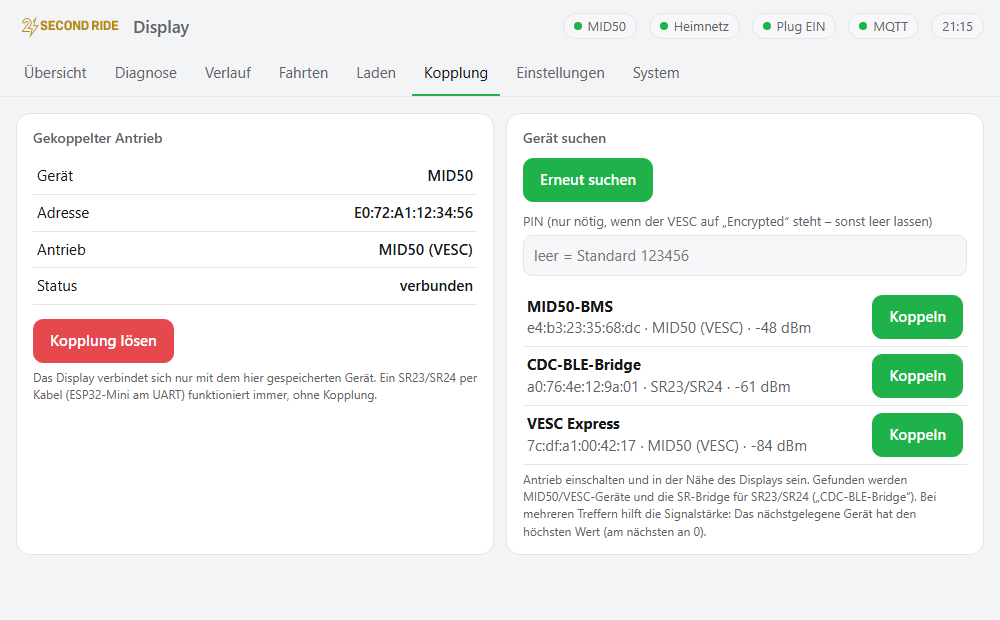

Ist keines der gespeicherten WLANs erreichbar, etwa unterwegs, schaltet das Display wieder auf den Hotspot. Es sucht alle 30 Sekunden nach einem bekannten WLAN, solange niemand mit dem Hotspot verbunden ist.

Die Kopplung ist dauerhaft gespeichert. Das Display verbindet sich nur mit dem gekoppelten Gerät; andere Antriebe in der Nähe stören nicht. Unter Kopplung → **Kopplung lösen** kannst du sie aufheben.

## Bedienung am Display

Das Display hat sechs Bildschirme in einem Ring. Wischen nach links blättert weiter, nach rechts zurück: **Akkuanzeige → Einstellungen → Beschleunigung → Antrieb → Tacho → Musik** → wieder Akkuanzeige. Den Musik-Bildschirm überspringt das Display, solange kein iPhone verbunden ist. Nach dem Einschalten startet es mit der Akkuanzeige oder dem Tacho (einstellbar im Webinterface).

### Willkommen und Abschied

Beim Einschalten zeigt das Display 3 Sekunden das Startbild. In dieser Zeit verbindet es sich schon mit WLAN und Antrieb, danach folgt der Startbildschirm.

Das runde 1,75-Zoll-Display hat einen eigenen Akku. Damit es nicht weiterläuft, schaltet es sich 1 Sekunde nach dem Ausschalten des Mopeds selbst ab. Vorher zeigt es 3 Sekunden das Abschiedsbild und speichert Fahrt und Kilometerstand. Beim nächsten Einschalten des Mopeds startet es von allein.

Das 1,43-Zoll-Display läuft ohne eigenen Akku und geht mit dem Moped sofort aus. Fahrt und Kilometerstand sichert es laufend, die Uhrzeit hält eine kleine Knopfzelle für die Uhr.

### Akkuanzeige

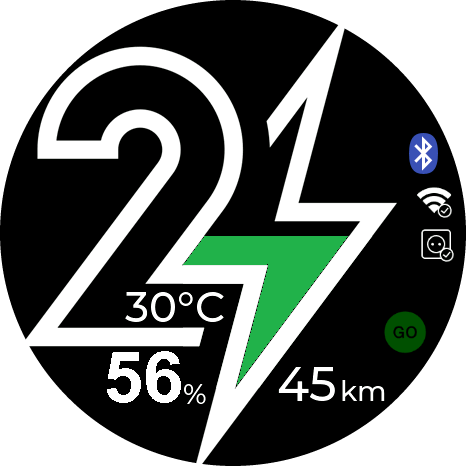

- Akkustand in Prozent und als grüne Füllung des Blitzes
- Reichweite in km
- Akkutemperatur: ab 40 °C orange, ab 45 °C rot hinterlegt
- Uhrzeit, wenn im Webinterface eingeschaltet
- Statussymbole am rechten Rand; beim Laden „Wird geladen mit … W bis … %“

Ist der Akku beim Laden 45 °C oder wärmer, erscheint statt der Ladeleistung ein Temperaturhinweis. Er verschwindet, wenn der Akku unter 40 °C abgekühlt ist.

### Einstellungen

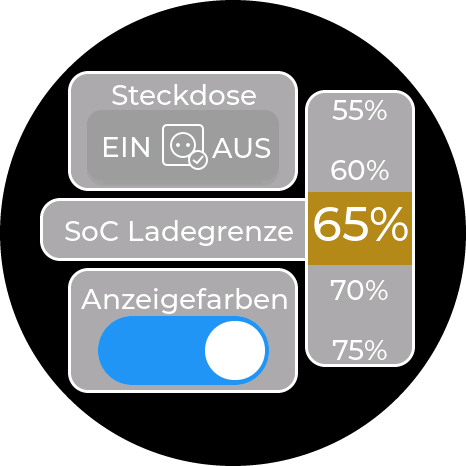

- **Steckdose:** Smartplug ein- und ausschalten
- **SoC-Ladegrenze:** Grenze in 5-%-Schritten drehen
- **Anzeigefarben:** zwischen Farbthema 1 und 2 umschalten; die Wahl bleibt gespeichert

### Beschleunigung

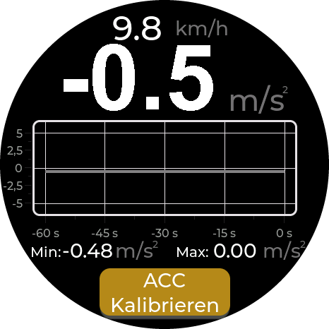

- Oben die Geschwindigkeit, darunter groß die aktuelle Längsbeschleunigung in m/s²: positiv beim Beschleunigen, negativ beim Bremsen
- Das Diagramm zeigt die letzten 60 Sekunden. Es zeichnet auch auf, während ein anderer Bildschirm angezeigt wird. Normal reicht die Skala bis ±5 m/s², bei stärkeren Werten wächst sie mit
- **Min** und **Max:** stärkstes Bremsen und stärkstes Beschleunigen seit dem Kalibrieren
- Taste **ACC Kalibrieren**

**Kalibrieren:** Moped auf ebenem Boden abstellen, Bildschirm Beschleunigung öffnen und ACC Kalibrieren tippen. Das Display merkt sich die Einbaulage, schräger Einbau wird berücksichtigt; Min und Max beginnen neu. Zeigt die Beschleunigung beim Anfahren ins Minus, im Webinterface „Vorzeichen umkehren“ setzen.

### Antrieb

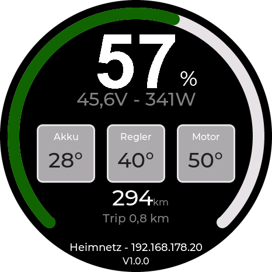

- **Bogen und große Zahl:** Akkustand in Prozent. Der Bogen ist beim Fahren grün und beim Laden blau
- **Darunter:** Akkuspannung und aktuelle Leistung, zum Beispiel „45,6V - 341W“; beim Laden „Lädt - 350W“
- **Hinweiszeile:** „Leistung begrenzt - 80%“, wenn der Antrieb die Leistung drosselt (SR23/SR24: wegen Ladestand oder Temperatur; MID50: wenn das Steuerprogramm den Entladestrom begrenzt); sonst leer
- **Beim Laden** steht dort stattdessen die Restladezeit, zum Beispiel „Noch 45 min bis 80%“ oder „Noch 1:20 h bis 100%“. Ziel ist die Ladegrenze, wenn der Akku darunter liegt, sonst 100 %. Gegen Ende des Ladens nimmt das Ladegerät die Leistung zurück, die Zeit wächst dann etwas mit. Ist das Ziel erreicht: „Ladegrenze 80% erreicht“ bzw. „Akku voll“
- **Akku, Regler, Motor:** Temperaturen. Das Feld wird orange mit roter Schrift, wenn es warm wird, und rot mit weißer Schrift, wenn es zu heiß wird (Grenzen in der Tabelle). Beim SR23/SR24 stehen Regler und Motor auf „--“, solange der Antrieb nicht fahrbereit ist (vor GO und beim Laden) – der Antrieb meldet dann keine Temperaturen
- **Kilometer:** Gesamtstand, darunter die Tageskilometer (Trip)
- **Unten:** WLAN-Name und IP-Adresse des Displays, im Hotspot „Hotspot - 192.168.4.1“, darunter die Firmware-Version

| Feld | Orange ab | Rot ab |
|---|---|---|
| Akku | 40 °C | 45 °C |
| Regler | 60 °C | 75 °C |
| Motor | 80 °C | 100 °C |

### Tacho

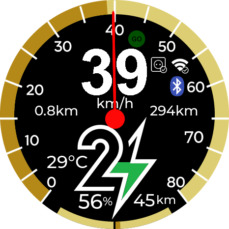

- Geschwindigkeit als Zahl und als Zeiger (0–80 km/h)
- Äußerer Bogen = Leistung: nach rechts beim Fahren, nach links beim Rekuperieren
- Links Tageskilometer, rechts Gesamtkilometer
- Unten Akkustand, Reichweite und Akkutemperatur (Farben wie bei der Akkuanzeige), dazu die Uhrzeit, wenn eingeschaltet
- Statussymbole am rechten Rand

### Musik (iPhone)

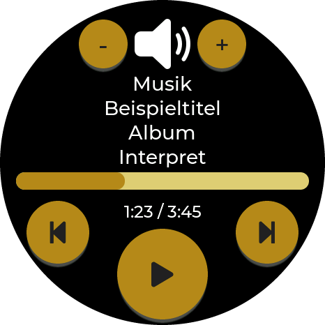

Mit einem gekoppelten iPhone steuerst du die Musik am Display, egal aus welcher App (Spotify, Apple Music, Podcasts). Das läuft per Bluetooth neben der Verbindung zum Antrieb.

- Oben Lautstärke leiser (–) und lauter (+)
- Name der App, Titel, Album und Interpret; lange Texte laufen durch
- Fortschrittsbalken mit Position und Länge des Titels
- Unten Titel zurück, Wiedergabe/Pause und Titel vor

**Erstes Koppeln:** iOS zeigt das Display nicht unter Einstellungen → Bluetooth an. Deshalb einmalig die kostenlose App **nRF Connect** nutzen:

1. Moped einschalten, am iPhone nRF Connect öffnen und nach „SR-Display“ suchen – so heißt das Display per Bluetooth. Hinter dem Namen stehen vier Zeichen aus der Geräteadresse, etwa „SR-Display 5E9D“; so unterscheidest du mehrere Displays.
2. **Connect** tippen. Das iPhone fragt nach der Kopplung und zeigt einen Code. Das Display bestätigt ihn selbst; den Code zeigt es während der Kopplung auch auf dem Musik-Bildschirm.
3. Am iPhone **Koppeln** tippen und nRF Connect schließen. Ab jetzt erscheint der Musik-Bildschirm beim Wischen.

Danach verbindet sich das iPhone bei jedem Einschalten von selbst, nRF Connect brauchst du nicht mehr. Um ein Display zu entfernen, es am iPhone unter Bluetooth „Ignorieren“.

### Über allen Bildschirmen

**Fehlermeldung:** Meldet der MID50 einen Fehler, erscheint über jedem Bildschirm ein rotes Fenster mit Fehlernummer und Klartext, zum Beispiel „Fehler 6 – Motor überhitzt“. Antippen blendet es aus; es kommt wieder, wenn ein anderer Fehler auftritt oder der Fehler erneut auftritt. Ist der Fehler behoben, verschwindet es von selbst. Der SR23/SR24 liefert keine Fehlercodes.

**Abdunkeln beim Laden:** Lädt das Moped, wird das Display nach 2 Minuten ohne Berührung schwarz. Antippen weckt es; diese erste Berührung löst nichts aus. Bei Ladeende, bei einer Fehlermeldung und beim Abschalten geht es von selbst wieder an.

### Statussymbole

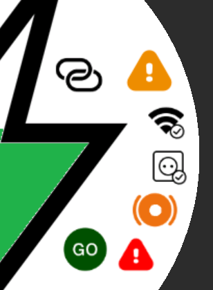

| Symbol | Bedeutung |
|---|---|
| Kettenglied | Hotspot aktiv: eigenes WLAN „SR HotSpot 192.168.4.1“ |
| WLAN mit Haken | Mit einem WLAN verbunden |
| Steckdose mit Haken | Smartplug erreichbar |
| GO (grün) | Antrieb fahrbereit (MID50: Modus DRIVE) |
| Bremse (orange) | Bremse betätigt (nur SR23/SR24) |
| Warndreieck (orange) | Leistung begrenzt (Ladestand, Temperatur oder Drosselung durch den MID50), oder Fehlercode |
| Ausrufezeichen (rot) | Keine Daten vom Antrieb |
| Bluetooth (blau) | Per Bluetooth gekoppelter Antrieb ist verbunden (MID50 oder SR-Bridge) |
| Bluetooth (rot) | Gekoppelter Antrieb ist nicht verbunden; ohne Bluetooth-Kopplung (Kabel) fehlt das Symbol ganz |

## Webinterface

Das Webinterface erreichst du im Heim-WLAN unter **http://srdisplay/** und unterwegs über den Hotspot unter **http://192.168.4.1**. Es läuft im Browser von Handy und PC und braucht kein Internet.

| Reiter | Inhalt |
|---|---|
| Übersicht | Ladestand, Geschwindigkeit, Spannung, Strom, Leistung, Reichweite, Temperaturen, Statusmeldungen; beim Laden die Restladezeit („Lädt – noch 1:20 h bis 80 %“) |
| Diagnose | Einzelzellen und Temperaturfühler (MID50), alle Rohwerte des Antriebs, Smartplug, Displaystatus |
| Verlauf | Diagramme der letzten Minuten bis Stunden: Geschwindigkeit, Leistung, Ladestand, Temperaturen |
| Fahrten | Die letzten 30 Fahrten mit Strecke, Fahrzeit, Tempo, Verbrauch und Temperaturen |
| Laden | Smartplug schalten, Ladegrenze, die letzten 30 Ladevorgänge |
| Kopplung | Bluetooth-Gerät suchen, koppeln oder Kopplung lösen |
| Einstellungen | WLAN, Smartplug je WLAN, WhatsApp, MQTT, Antrieb, Anzeige, Farben, Beschleunigungssensor |
| System | Fahrtenschreiber, Protokoll, Bildschirmfoto, Kilometerstand, Firmware-Update, Neustarts und Abstürze, Neustart |

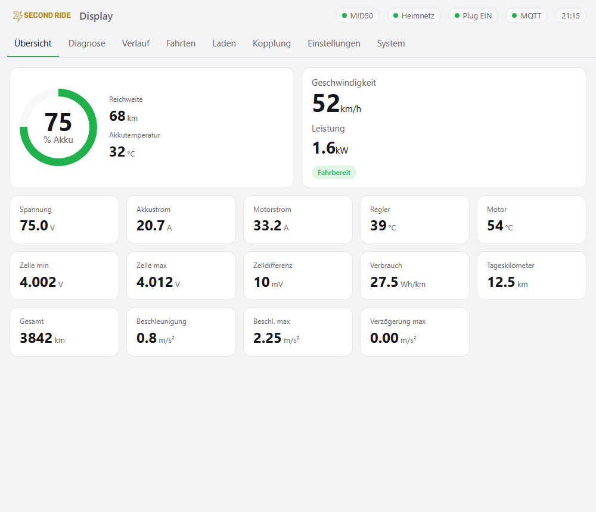

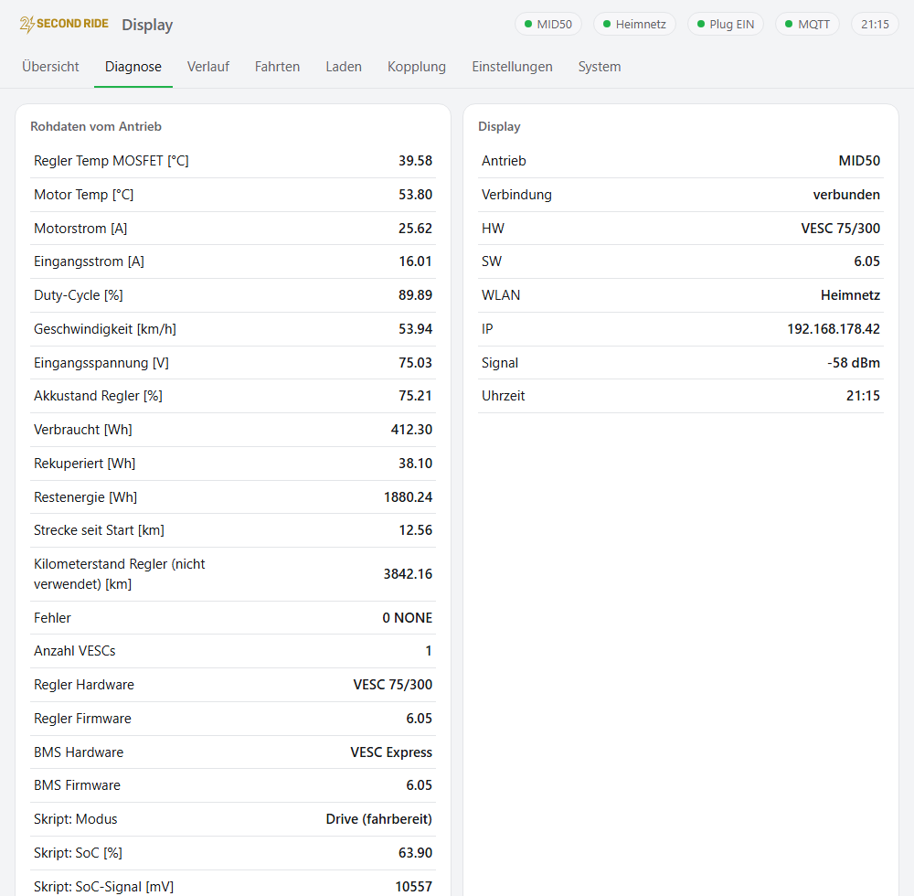

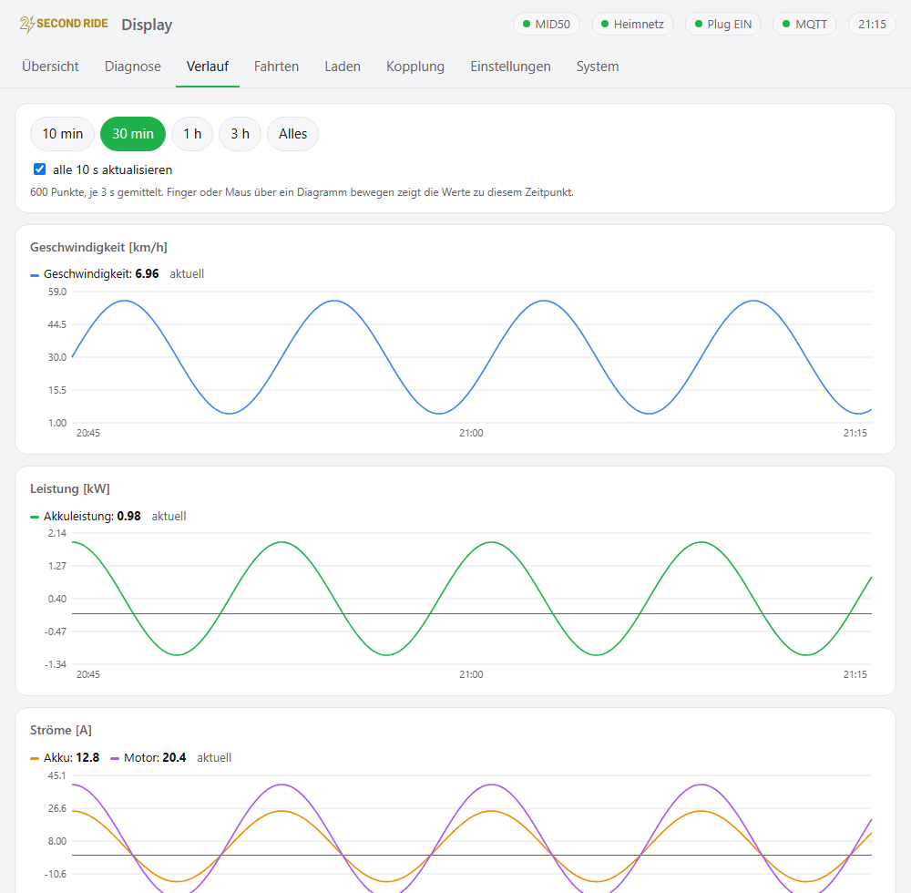

Änderungen unter Einstellungen werden erst mit **Speichern** übernommen und bleiben auch nach dem Ausschalten erhalten.

## Laden

Mit einem Smartplug am Ladegerät beendet das Display das Laden selbst, sobald die eingestellte Ladegrenze erreicht ist. Das schont den Akku, wenn er nicht jedes Mal auf 100 % geladen werden muss.

**Smartplug einrichten**

1. Smartplug (Shelly ab Generation 2 oder Tasmota) in dein WLAN bringen und seine IP-Adresse notieren. Am besten im Router eine feste IP vergeben.
2. Webinterface → **Einstellungen** → bei dem WLAN, in dem der Smartplug hängt: IP-Adresse und Typ eintragen, **Speichern**.
3. Unter **Laden** erscheint der Smartplug mit Status, Leistung, Spannung und Strom.

Die Plug-Einstellung gilt nur für das jeweilige WLAN. So kannst du zu Hause und an einem zweiten Ort je einen eigenen Smartplug nutzen. Als WLAN 2 lässt sich auch der Hotspot eines Smartplugs eintragen; dann funktioniert das Schalten auch ohne Router.

**Ladegrenze**

Die Ladegrenze stellst du im Webinterface unter Laden oder am Display im Bildschirm Einstellungen ein, in 5-%-Schritten.

- Ob geladen wird, erkennt das Display allein am Antrieb – der Smartplug zählt dafür nicht. Es gilt erst nach 30 Sekunden als Ladevorgang, kurze Zustände beim Einstecken zählen nicht.
- Beim SR23/SR24 meldet der Antrieb das Laden selbst. Beim MID50 erkennt das Display es am Akkustrom: mindestens 4 A, Moped steht, 10 Sekunden lang.
- Reißt die Bluetooth-Verbindung beim Laden kurz ab, läuft der Ladevorgang bis zu 60 Sekunden weiter und zerfällt nicht in mehrere Einträge.
- Erreicht der Ladestand die Grenze, schaltet das Display den Smartplug aus. Wurde eine WhatsApp-Nachricht verschickt, erst 30 Sekunden danach – mit der Ladespannung geht oft auch das Display aus.
- War der Akku schon beim Einstecken über der Grenze, wird ebenfalls abgeschaltet, aber keine Nachricht verschickt.

**WhatsApp-Nachricht**

Das Display kann über den kostenlosen Dienst CallMeBot eine WhatsApp-Nachricht schicken, wenn die Ladegrenze während des Ladens erreicht wird. Telefonnummer und den API-Schlüssel von CallMeBot unter **Einstellungen → WhatsApp** eintragen, speichern und mit **Testnachricht senden** prüfen. Ohne Smartplug kommt beim Erreichen der Grenze nur die Nachricht. Das funktioniert nur, wenn das Display im WLAN mit Internet hängt. Ob CallMeBot die Nachricht angenommen hat, steht im Protokoll unter System (Zeile `[WA]`, z. B. „Message queued“ oder eine Fehlermeldung von CallMeBot).

**Ladehistorie**

Unter Laden stehen die letzten 30 Ladevorgänge mit Beginn, Dauer, Ladestand vorher und nachher, der in den Akku geladenen Energie und, mit Smartplug, dem Verbrauch an der Steckdose inklusive Ladeverlusten. Ein laufender Ladevorgang wird alle 5 Minuten gesichert.

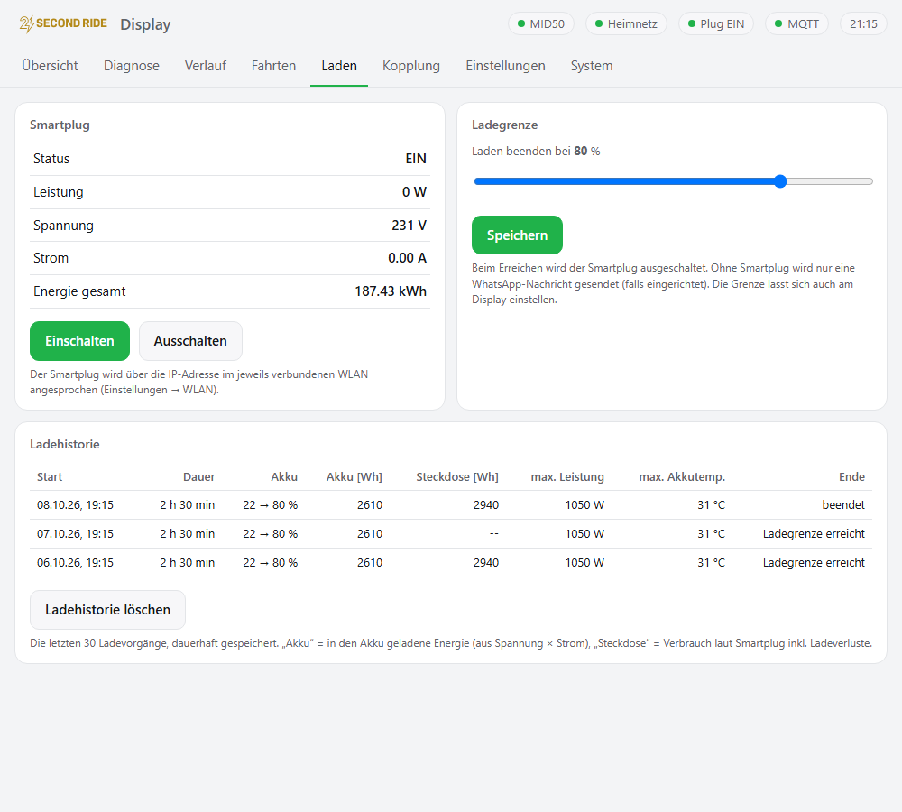

## Fahrten, Verlauf und Aufzeichnung

Das Display zeichnet jede Fahrt automatisch auf. Fahrten und Ladevorgänge bleiben dauerhaft gespeichert, die sekündliche Aufzeichnung nur bis zum Ausschalten.

**Fahrten**

- Eine Fahrt beginnt mit dem Einschalten des Mopeds und endet mit dem Ausschalten.
- Sie endet außerdem, wenn das Laden beginnt oder 60 Sekunden lang keine Daten vom Antrieb kommen.
- Fahrten unter 100 m werden verworfen.
- Gespeichert werden die letzten 30 Fahrten: Start, Fahrzeit, Strecke, Durchschnitts- und Höchstgeschwindigkeit, Verbrauch, Energie und Rekuperation, Ladestand vorher und nachher, Höchsttemperaturen.
- Die Fahrzeit zählt nur die Zeit in Bewegung, Standzeiten an der Ampel oder beim Parken mit eingeschaltetem Moped nicht.

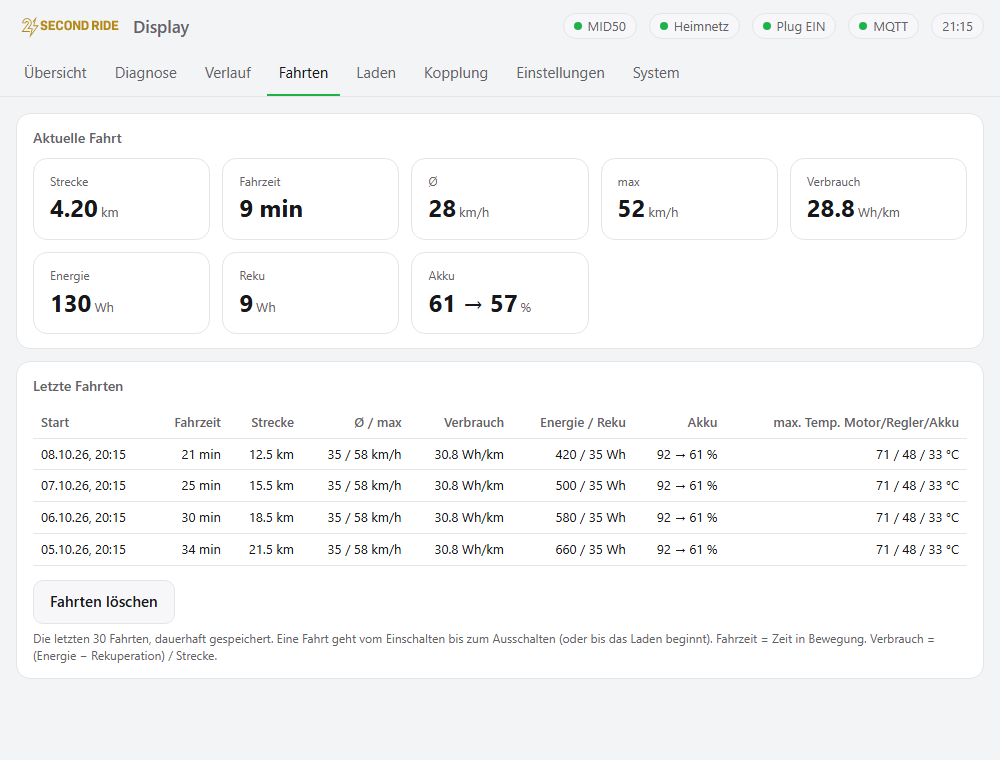

**Verlauf**

Der Reiter Verlauf zeigt Diagramme für 10 Minuten, 30 Minuten, 1 Stunde, 3 Stunden oder alles seit dem Einschalten. Mit dem Finger oder der Maus über ein Diagramm fahren zeigt die Werte zu diesem Zeitpunkt. Die Diagramme funktionieren auch im Hotspot ohne Internet.

**Fahrtenschreiber**

Jede Sekunde werden alle wichtigen Werte aufgezeichnet, insgesamt fast 14 Stunden. Unter **System → Fahrtenschreiber** lädst du sie als CSV-Datei herunter. Die Datei öffnet sich direkt in Excel mit deutschen Zahlen. Die Aufzeichnung ist für die Fehlersuche gedacht und geht beim Ausschalten verloren; vorher herunterladen.

Zur Auswertung am PC lädst du unter System → Fahrtenschreiber mit dem Knopf Auswertungs-Tool einmal herunter: die Datei **fahrtenschreiber_auswertung.html**. Im Browser öffnen, die CSV-Datei wählen oder ins Fenster ziehen. Sie zeigt alle Werte als Kurven über der Zeit und Kennzahlen wie Strecke, Verbrauch und Höchsttemperaturen. Im Diagramm ziehen vergrößert einen Ausschnitt, die Kennzahlen gelten dann für diesen Ausschnitt. Die Datei braucht kein Internet; die Daten bleiben auf dem PC.

**Kilometerzähler**

Das Display zählt Tages- und Gesamtkilometer selbst aus der Geschwindigkeit, bei beiden Antrieben. Die Tageskilometer beginnen bei jedem Einschalten bei 0. Den Gesamtstand speichert es, sobald das Moped steht und seit dem letzten Speichern mehr als 500 m gefahren wurden. Unter **System → Kilometerstand** kannst du ihn setzen, etwa beim Einbau oder nach einem Tausch des Displays.

## Einstellungen

Alle Einstellungen findest du im Webinterface unter **Einstellungen**; sie gelten nach **Speichern** sofort.

| Einstellung | Wirkung | Standard |
|---|---|---|
| Geschwindigkeit trimmen (Faktor) | Gleicht anderen Radumfang oder andere Ritzel aus. 1,1 zeigt 10 % mehr an. Wirkt auch auf Kilometerzähler, Fahrten, Reichweite und Verbrauch je km. Erlaubt 0,5 bis 2,0. | 1,0 |
| Verbrauch für Reichweite [Wh/km] | Nur MID50: Reichweite = Restenergie beider Akkus ÷ dieser Wert. Beispiel: 4000 Wh ÷ 37 Wh/km = 108 km. Beim SR23/SR24 kommt die Reichweite vom Antrieb | 25 |
| CAN-ID Motorcontroller | Nur MID50, nur nach Anweisung ändern | 15 |
| Startbildschirm | Akkuanzeige oder Tacho nach dem Einschalten | Akkuanzeige |
| Anzeige drehen | Dreht den Bildschirminhalt in 90°-Schritten (0°, 90°, 180°, 270°), passend zur Einbaulage; die Touch-Bedienung dreht mit | 0° |
| Uhrzeit anzeigen | Uhr auf Akkuanzeige und Tacho | aus |
| Helligkeit | Helligkeit des Displays | – |
| Farbthema | Zwei Farbthemen (hell und dunkel) mit je fünf frei wählbaren Farben; umschalten auch am Display | hell |
| Beschleunigungssensor | Achse in Fahrtrichtung und Vorzeichen, Kalibrieren | Y, umgekehrt |

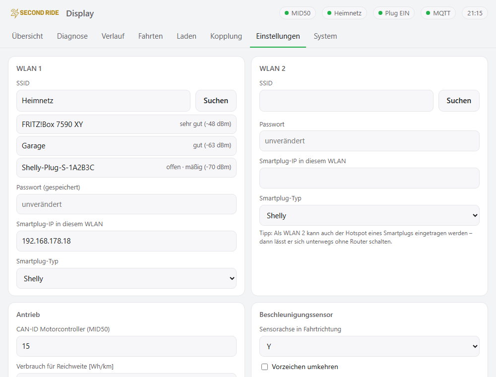

**Geschwindigkeit trimmen:** Vergleiche die Anzeige mit einem GPS-Tacho oder dem Handy bei gleichmäßiger Fahrt. Faktor = GPS-Geschwindigkeit ÷ angezeigte Geschwindigkeit, zum Beispiel 44 ÷ 40 = 1,1.

**Uhrzeit:** Das Display holt die Uhrzeit aus dem Internet, sobald es im WLAN ist. Ohne Internet, etwa nur über den Hotspot, übernimmt es sie automatisch vom Browser (Handy oder PC), sobald du das Webinterface öffnest; unter System → Gerät lässt sie sich mit „Uhrzeit vom Browser übernehmen“ auch nachstellen. Mit Pufferbatterie für die Uhr bleibt die Zeit beim Ausschalten erhalten. Ohne Batterie und ohne gestellte Uhr stehen Fahrten und Ladevorgänge als „Einschaltung 57“ (Nummer des Einschaltvorgangs) statt mit Datum in der Liste, und die Uhrzeit-Anzeige lässt sich unter Einstellungen abschalten.

**MQTT**

Für die Anbindung an eine Hausautomation (zum Beispiel Home Assistant oder ioBroker) Server, Port, Benutzer, Passwort und einen Gerätenamen eintragen. Das Display sendet seine Werte dann unter diesem Namen:

- `<Name>/…` – Werte des SR23/SR24, wie beim bisherigen Display
- `<Name>/vesc/…` – Werte des MID50
- `<Name>/common/…` – gemeinsame Werte beider Antriebe, etwa Ladestand und Geschwindigkeit

## Zugangsschutz

Im Auslieferungszustand sind Webinterface und Hotspot offen. Unter **Einstellungen → Zugangsschutz** lassen sich zwei Passwörter setzen:

- **Passwort Webinterface:** Der Browser fragt beim Öffnen nach Benutzername und Passwort. Benutzername ist immer **admin**. Ohne Passwort lässt sich auch keine Firmware einspielen.
- **Passwort Hotspot:** schützt das WLAN „SR HotSpot 192.168.4.1“ (8 bis 63 Zeichen). Bist du gerade über den Hotspot verbunden, trennt das Speichern die Verbindung – danach mit dem neuen Passwort neu verbinden.

**Passwort vergessen?** In den ersten 20 Sekunden nach dem Einschalten den Bildschirm des Displays 5 Sekunden lang gedrückt halten. Beide Passwörter werden gelöscht, das Display zeigt einen Hinweis.

Der Schutz hält Neugierige fern. Die Verbindung selbst ist nicht verschlüsselt (http), deshalb kein Passwort verwenden, das du auch anderswo nutzt.

## Firmware-Update und System

Neue Firmware spielst du ohne Kabel über das Webinterface ein. Alle Einstellungen, Kopplung, Kilometerstand, Fahrten und Ladehistorie bleiben dabei erhalten.

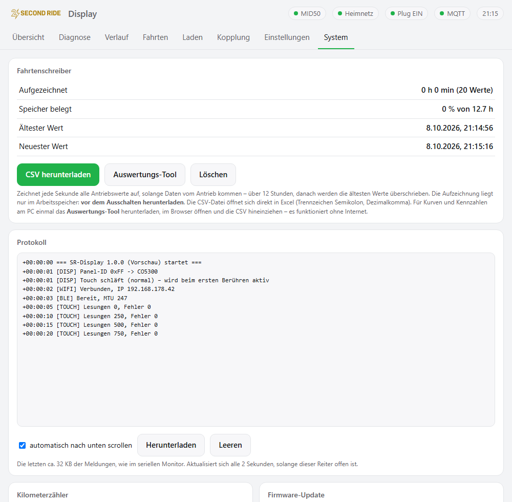

**Firmware-Update**

1. Die neue Firmware-Datei `firmware.bin` auf Handy oder PC speichern.
2. Webinterface → **System → Firmware-Update**, Datei auswählen und hochladen.
3. Nach „Update installiert“ startet das Display neu. Das dauert etwa eine halbe Minute.

Während des Updates das Moped nicht ausschalten. Den Fahrtenschreiber vorher herunterladen, falls du die Aufzeichnung brauchst; er wird beim Neustart geleert.

Es gibt eine eigene Firmware-Datei für das 1,43-Zoll- und das 1,75-Zoll-Display. Erwischst du die falsche, lehnt das Display sie ab („Falsche Platine …“) und läuft mit der bisherigen Firmware unverändert weiter. Ältere Firmware-Dateien (vor Oktober 2026) haben noch keine Platinenkennung; zum Einspielen einer solchen Version den Haken „Ohne Platinenprüfung“ setzen – dann aber genau auf die richtige Datei achten.

**Neustarts und Abstürze**

Stürzt das Display einmal ab, startet es von selbst neu und merkt sich die Ursache. Unter **System → Neustarts und Abstürze** stehen der Grund des letzten Neustarts (zum Beispiel „Einschalten“ oder „Absturz“), die Zahl der gespeicherten Abstürze und die Einzelheiten zum letzten. Bei Problemen diesen Text zusammen mit dem Protokoll mitschicken; mit **Bericht löschen** setzt du den Zähler zurück.

**Protokoll**

Unter **System → Protokoll** stehen die Meldungen des Displays: Verbindungsaufbau, WLAN, Smartplug, Laden, Fehler. Bei Problemen hilft es, diesen Text mitzuschicken. Er lässt sich dort auch leeren.

**Neustart**

**System → Neu starten** startet das Display neu, ohne dass du das Moped ausschalten musst. Unter System siehst du außerdem Firmware-Version, Laufzeit und Speicher.

**Bildschirmfoto**

Unter **System → Bildschirmfoto** lädst du die Anzeige des Displays als Bild herunter (BMP, 466 × 466 Pixel), auch von Bildschirmen, die gerade nicht angezeigt werden. Mit „Private Angaben ausblenden“ ersetzt das Display WLAN-Name, IP-Adresse und Musiktitel durch Beispiele, etwa für eine Anleitung. Fehlermeldungen sind nur auf dem Display selbst zu sehen.

## Fehlersuche

Die meisten Probleme lassen sich mit dem Protokoll unter System eingrenzen.

| Problem | Mögliche Ursache | Abhilfe |
|---|---|---|
| Touch reagiert nicht | Touch-Chip hängt | Moped ganz ausschalten, einige Sekunden warten, wieder einschalten. Ein Neustart über das Webinterface reicht nicht. |
| Symbol „Keine Daten“, Werte zeigen „--“ | Antrieb aus, nicht gekoppelt, Kabel lose | Antrieb einschalten; Reiter Kopplung prüfen; bei Kabel die Steckverbindungen prüfen |
| MID50 verbindet sich nicht | Falsches Gerät gekoppelt oder falsche PIN | Kopplung lösen, neu suchen und koppeln; bei „Encrypted“ die PIN eingeben |
| SR23/SR24 per Kabel ohne Daten | ESP32-Mini hat alte Firmware | SR-Bridge-Firmware aufspielen lassen; im Protokoll zeigen Zeilen `[UART]`, was ankommt |
| Smartplug „nicht eingerichtet“ | IP bei einem anderen WLAN eingetragen | IP bei dem WLAN eintragen, mit dem das Display gerade verbunden ist |
| Smartplug „nicht erreichbar“ | Falsche IP oder anderes Netz | IP im Router prüfen, feste IP vergeben |
| http://srdisplay/ öffnet nicht | Name wird im Netz nicht aufgelöst | IP-Adresse vom Bildschirm Antrieb (unten) verwenden |
| Geschwindigkeit weicht ab | Anderer Radumfang oder Ritzel | Faktor unter Einstellungen → Antrieb anpassen |
| Beschleunigung zeigt beim Anfahren ins Minus | Display andersherum eingebaut | „Vorzeichen umkehren“ setzen und im Stand kalibrieren |
| Laden wird nicht erkannt | Ladestrom zu klein oder zu kurz | Erkannt wird am Antrieb (MID50: ab 4 A), erst nach 30 Sekunden; der Smartplug zählt nicht |
| Display startet von selbst neu | Absturz | System → Neustarts und Abstürze ansehen und den Text mit dem Protokoll mitschicken |
| Firmware-Update „Falsche Platine“ | Datei für das andere Display (1,43″/1,75″) | Die passende Datei wählen – das Display läuft unverändert weiter |
| Webinterface fragt nach Passwort, das keiner mehr weiß | Passwort gesetzt und vergessen | In den ersten 20 s nach dem Einschalten den Bildschirm 5 s gedrückt halten |
| Bild steht quer oder auf dem Kopf | Einbaulage | Einstellungen → Anzeige → „Anzeige drehen“ |
| Keine WhatsApp-Nachricht | Kein Internet, falscher Schlüssel, Grenze schon beim Einstecken überschritten | Testnachricht senden; Nachricht kommt nur, wenn die Grenze während des Ladens erreicht wird |
